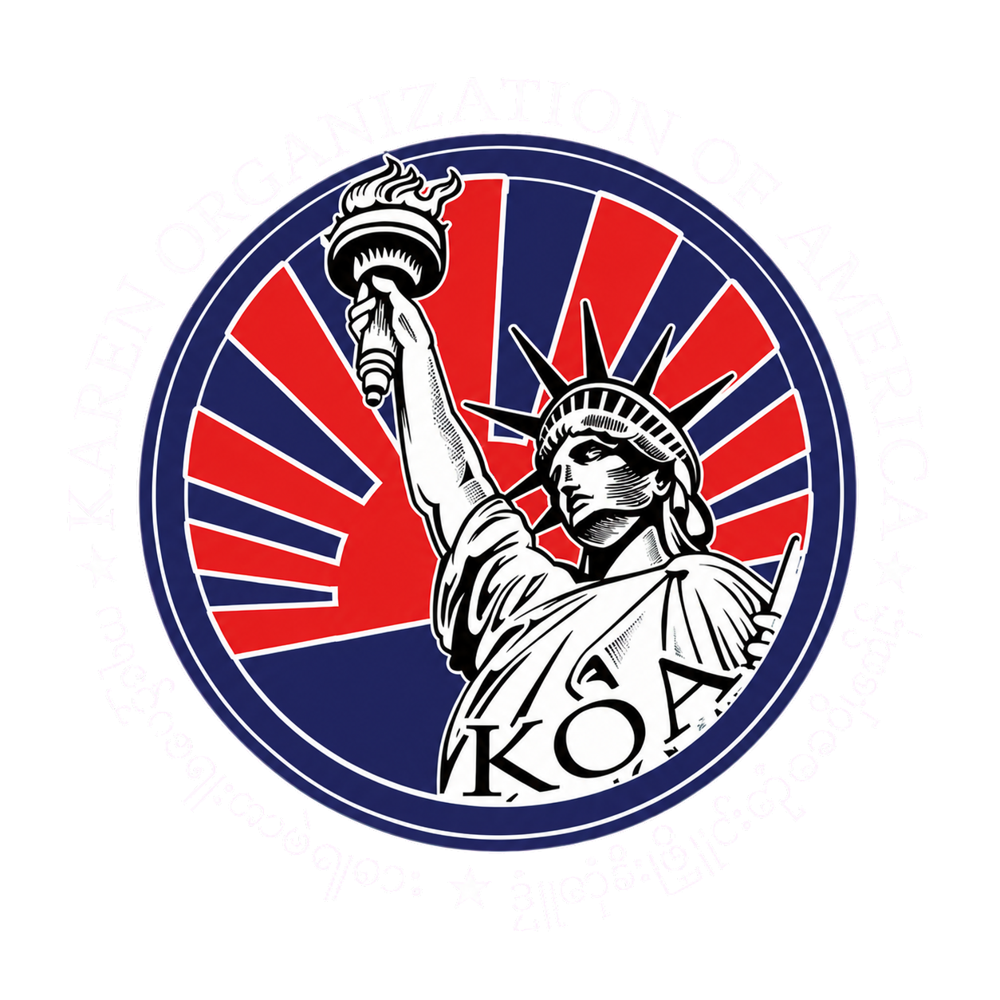

# Karen Organization of America cinematic website

This repository is the canonical React App Router application for the Karen Organization of America (KOA) website. It combines the public mission experience, slow cinematic storytelling, multilingual content, and protected administration in one codebase.

The current phase is local-only. It is not an official publication or deployment. Translations, organization relationships, photographs, cultural copy, and donation behavior remain review-gated.

Home is a single-screen KOA introduction with the supplied seal, a top-down name reveal, a subtly breathing K–seal–A, and direct paths to Programs, Get involved, and Contact. Home's denser serif-shaped K/A glyphs and the seal share a larger mark; the seal tilts gently toward the pointer. The shared background uses a fixed S'gaw glyph grid with 12px spacing: pointer speed raises same-color glyph substitutions, faster movement widens a shorter ripple, and clicks send outward glyph-change waves. Foreground Karen-glyph motes travel slowly on straight paths with long fades. The English and Karen names share a blue-to-red-to-gold type treatment; glass controls have traveling edge light and reversible glare. Per owner direction, reduced-motion visitors see complete static text while subtle ambient grid, dust, K/A, and seal motion continues; the prior long film remains in `components/CinematicLanding.tsx` for comparison. Public copy and media still require owner review.

The Home K/A now use fewer, lighter glyphs at 1.5–2.5× their former size. The Karen name uses Noto Serif Myanmar with extra room for diacritics; the subheading uses the display serif and the buttons use Inter.

## Start here

- [Local version library](docs/koa-version-library-review.md) — review every saved HTML path, historical branch, strengths, gaps, and the recommended deployment base. Run `Set-Location 'C:\Users\olive\Projects\koa-website'; node .\scripts\koa-version-library.mjs` to open the one-click local dashboard; press Ctrl+C in that PowerShell window to stop it.

- [Cinematic cookbook](docs/KOA-CINEMATIC-COOKBOOK.md) — choreography, motion parameters, failure history, weighted references, and media.
- [Repository understanding](UNDERSTANDING.md) — curated ownership, consumers, removal impact, verification, and approval boundaries for top-level paths.
- [Home design](docs/pages/home/design.md), [spec](docs/pages/home/spec.md), and [ideas](docs/pages/home/ideas.md) — route-specific intent, contract, and explicitly deferred possibilities.
- [Phase 7 frame story](docs/cinematic/versions/v0007-phase7.md) — deterministic human-readable snapshot of the canonical frame manifest.
- [Canonical one-app design](docs/superpowers/specs/2026-08-24-koa-canonical-one-app-consolidation-design.md) — approved architecture and acceptance criteria.
- [Request adherence ledger](docs/codex/REQUEST_ADHERENCE_LEDGER.md) — implemented, verified, deferred, and blocked requirements.
- [Progress](docs/progress.md) and [decisions](docs/decisions.md) — phase history and rationale.

## Canonical application

- `app/[lang]` — public React routes and language pivots.
- `app/[lang]/admin` — authenticated administration.
- [`components/CinematicHome.tsx`](components/CinematicHome.tsx) — current React home-film composition.
- [`components/i18n.ts`](components/i18n.ts) and [`messages/`](messages) — current locale loader and catalogs.
- [`db/schema.ts`](db/schema.ts) — content, translation, dictionary, and review data.
- [`public/koa`](public/koa) — temporary read-only static visual reference; it is not a second product.
- [`scripts/`](scripts) and [`tests/`](tests) — verification and the one-command local runner.

The separate `koa-website-bilingual` worktree is historical. Its feature commit is already merged into `main`; it will be removed only after generated artifacts are reviewed and the React application has fresh parity proof.

## View the current static reference

The static film reference remains available for read-only parity checks. Paste this once into PowerShell to open it. Closing the PowerShell session does not automatically stop the hidden process; use the printed stop command.

```powershell
Set-Location 'C:\Users\olive\Projects\koa-website'; $global:KoaPreviewProcess = Start-Process -FilePath 'python' -ArgumentList '-m','http.server','8123','--bind','127.0.0.1','--directory','public\koa' -WorkingDirectory (Get-Location) -WindowStyle Hidden -PassThru; Start-Sleep -Seconds 1; Start-Process 'http://127.0.0.1:8123/index.html'; Write-Host "KOA reference: http://127.0.0.1:8123/index.html`nStop with: Stop-Process -Id $($global:KoaPreviewProcess.Id)"
```

## Permanent canonical command

Start the canonical React application with this one paste:

```powershell
Set-Location 'C:\Users\olive\Projects\koa-website'; powershell -NoProfile -ExecutionPolicy Bypass -File '.\scripts\run-koa.ps1'
```

The runner verifies dependencies, starts exactly one vinext process, waits for readiness, opens the English route, and prints the exact stop command. It never deploys.

Stop the owned local runtime with:

```powershell
powershell -NoProfile -ExecutionPolicy Bypass -File '.\scripts\stop-koa.ps1'
```

## Development commands

```powershell
Set-Location 'C:\Users\olive\Projects\koa-website'
npm.cmd ci
npm.cmd run dev
npm.cmd test
npm.cmd run build
```

Regenerate durable repository and frame documentation with:

```powershell
node scripts/update-understanding.mjs
node scripts/snapshot-cinematic-spec.mjs --version v0007-phase7 --commit c827016 --evidence-dir output/playwright
node scripts/update-understanding.mjs --check
node scripts/snapshot-cinematic-spec.mjs --version v0007-phase7 --commit c827016 --evidence-dir output/playwright --finalize
```

`--finalize` is a read-only cleanliness gate: it rejects a missing or stale generated snapshot instead of rewriting it.

## Key media



- [Exact rotating-annulus seal source](public/koa/assets/koa-seal-white-lettering-v2.png)
- [Capitol community group](public/koa/assets/fb-capitol-group-mobile-enhanced.png)
- [Community group](public/koa/assets/fb-community-group-mobile-enhanced.png)
- [Capitol flags](public/koa/assets/fb-capitol-flags-mobile-enhanced.png)
- [Outdoor gathering](public/koa/assets/fb-outdoor-gathering-mobile-enhanced.png)
- [Phase 6 cursor-matrix proof](output/playwright/phase6-cursor-matrix.jpg)
- [Phase 6 navigation-glimmer proof](output/playwright/phase6-nav-glimmer.jpg)
- [Phase 6 mobile-film proof](output/playwright/phase6-mobile-film.jpg)
- [Phase 6 mobile Motion-off proof](output/playwright/phase6-mobile-motion-off.jpg)
- [Phase 6 runtime evidence](output/playwright/phase6-runtime-evidence.json)

The Facebook-derived files are local draft references. Original files, provenance, subject consent, and reuse rights must be documented before public use.

## Design principles

- One cinematic message per viewport, with long reading holds and breathing room.
- Preserve the K–seal–A choreography and exact seal identity.
- Keep glyphs behind foreground content and sparse enough to remain atmospheric.
- Use Hermes blue fields, red interaction, and restrained gold ceremony.
- Maintain complete, readable mobile and Motion-off compositions.
- Treat English as source content; keep Thai, Burmese, and S'gaw Karen proposals traceable and reviewable.

## Approval boundaries

Local source changes and tests are allowed. Deployment, public publication, remote branch deletion, donation processing, claims of official partnership, and unreviewed translation publication require separate approval.
# Content and first-screen paths (2026-09-30)

`docs/koa-content-map.md` tracks owner-draft claims against live routes and open fact checks.
The home film now keeps Programs and Get involved reachable from its first screen.
`STYLESEED.md` records the local design lock; `.styleseed/` contains resolved working rules.

## Glyph atmosphere (2026-10-01)

The home loader scatters and reforms the proportional Karen-glyph K/A before revealing the one-screen introduction.
Shared dither glyphs react to pointer paths and clicks; photo glyphs use a quiet inverse-color tile.
The effect caps active ripples and caches letter sprites to keep the live canvas bounded.
The Karen long-form line box includes extra space for upper marks at short viewports.
Home follows the active locale for its title, supporting copy, controls, and glyph atmosphere; K/A remain Karen.
The three Home actions open image previews with a route link and keyboard dismissal.
